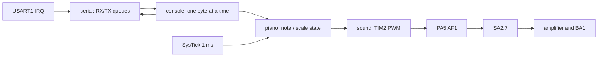

# Пояснения к защите лабораторной 3

## От ЛР 1 и 2 к ЛР 3

ЛР 1 разделяет GPIO, светодиоды, кнопку и автомат светофора. ЛР 2 добавляет
прикладной парсер команд и независимый UART-транспорт с кольцевыми очередями.
ЛР 3 сохраняет этот принцип, но заменяет светофор музыкальной клавиатурой.
Построчный парсер ЛР 2 не подходит: здесь действие выполняется по каждому байту.
Условие допускает один UART-драйвер, поэтому выбран уже проверенный HAL с IRQ.
HAL вычисляет BRR из текущей частоты APB2, а не из прежних 16 МГц.



`piano.c` не включает STM32-заголовки и не вызывает UART/таймер. Его результат —
текущая частота в миллигерцах либо ноль для тишины. `sound.c` не знает о нотах,
октавах или клавишах: он принимает частоту и настраивает аппаратный канал.

## Дерево частот

PLL получает HSI 16 МГц; внешнего кварца программа не требует:

```text
f_PLL_in = 16 / 8 = 2 MHz
f_VCO = 2 * 120 = 240 MHz
SYSCLK = f_VCO / 2 = 120 MHz
PLL48CLK = f_VCO / 5 = 48 MHz
HCLK = SYSCLK / 1 = 120 MHz
PCLK1 = HCLK / 4 = 30 MHz
PCLK2 = HCLK / 2 = 60 MHz
TIM2CLK = 2 * PCLK1 = 60 MHz (TIMPRE = 0)
```

APB1 нельзя оставить 120 МГц: для STM32F427 предельная частота этой шины 45 МГц.
APB2 допускает до 90 МГц. Удвоение частоты таймера при делителе APB > 1
относится к таймеру, но не к USART1. Для питания 3,3 В выбраны scale 1
и Flash latency 3. Перед перестройкой PLL процессор переводится на HSI;
это учитывает настройку PLL, которую мог оставить OpenOCD.
HAL перенастраивает SysTick при смене HCLK; итоговый LOAD = 119999.
USART1 при PCLK2=60 МГц и 57600 бод получает BRR=1042 (`0x412`).

## Генерация звука

PA5 имеет альтернативную функцию **AF1 = TIM2_CH1**. TIM2 включён в RCC APB1,
счёт направлен вверх, PSC=0. Канал работает в PWM mode 1, active-high:
выход высокий, пока CNT < CCR1, и низкий в остальной части периода.
`OC1PE` и `ARPE` включают предзагрузку CCR1 и ARR. Событие `UG` загружает
значения до старта, счётчик сбрасывается, затем устанавливается `CEN`.
Прерывания TIM2 не включены: фронты формирует периферия без работы CPU.

Для ноты с частотой `F_mHz` вычисляется целочисленно, с округлением:

```text
N = (60 000 000 * 1000 + F_mHz / 2) / F_mHz
ARR = N - 1
CCR1 = N / 2
duty = CCR1 / N ≈ 50 %
```

Промежуточное произведение имеет тип `uint64_t`. 32-разрядный TIM2 позволяет
использовать один PSC=0 и для низких нот. Для Ля 440 Гц: N=136364,
ARR=136363, CCR1=68182, фактически около 439,9988 Гц. При остановке CCR1=0
загружается через UG, счётчик выключается; CH1 остаётся включён, PA5 — низкий.
Между нотами гаммы нет программной паузы; смена регистров занимает несколько
инструкций. Аналоговый тракт и переключение PWM могут создавать щелчки.

Таблица содержит 63 частоты: семь натуральных нот в девяти октавах.
Формула равномерной темперации — `f = 440 * 2^((m - 69) / 12)`, где `m` — MIDI
номер ноты; C4=60, A4=69. Значения заранее округлены до 1 мГц, вычислений
с плавающей точкой в прошивке нет. Реальная точность зависит также от HSI.

## Автомат и UART

Одна нота хранит момент старта и длительность. Проверка
`(uint32_t)(now - started) >= duration` работает при переполнении SysTick.
Гамма хранит текущую ноту и снимок октавы/длительности. При позднем обновлении
деление прошедшего времени на длительность определяет, сколько нот истекло;
момент старта сдвигается на целое число длительностей, без накопления задержки.

Настройки, изменённые во время игры, применяются при следующем запуске.
Новая нота или Enter заменяет предыдущее воспроизведение. CRLF считается одним
Enter. Политика явно описана, поскольку задание не определяет эти случаи.
Консоль сообщает каждую ноту гаммы, не останавливая её ради отправки текста.

Приём/отправка используют ISR USART1 и очереди ЛР 2. Главный цикл обслуживает
очереди, ввод, автомат и PWM без `HAL_Delay` и ожидания передачи. Если в TX мало
места, обработка новых клавиш откладывается; звук продолжает отсчитываться.
При ошибке RX/переполнении очередь очищается, epoch меняется, консоль сообщает
потерю. Команды однобайтовые, поэтому ожидать Enter для восстановления не нужно.

## Что показать на защите

1. Частоты RCC, Flash latency, SysTick LOAD, USART1 BRR и AF1 на PA5.
2. С замкнутым SA2.7 сыграть `1`–`7`; в терминале показать ноту/октаву/длительность.
3. Проверить `+`, `-`, `A`, `a`, затем крайние значения 1/9 и 0,1/5 с.
4. Enter: семь нот подряд; в процессе изменить настройки, затем начать новую ноту.
5. Неверный символ: сообщение и код; после него следующая правильная клавиша работает.
6. На Ля первой октавы показать PSC=0, ARR=136363, CCR1=68182; по возможности
   измерить PA5 осциллографом. После окончания CCR1=0 и CEN=0.

Аппаратная проверка остаётся необходимой: эмулятор не воспроизводит усилитель,
BA1, USB/FT2232 и физическую точность генератора.

Источники: условие и схема из [README](../README.md),
[RM0090](https://www.st.com/resource/en/reference_manual/rm0090-stm32f407-advanced-armbased-32bit-mcus-stmicroelectronics.pdf),
[DS9405, таблица 12](https://www.st.com/resource/en/datasheet/stm32f427vi.pdf).
