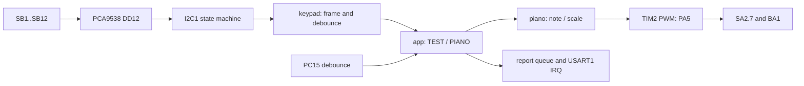

# Пояснения к защите лабораторной 4

## Что изменилось после ЛР 3

Задание 1 «Музыкальная клавиатура» сохранено, источник команд — матрица стенда.
UART выводит результаты, поступившие из терминала байты отбрасываются.
Начальный режим TEST показывает коды; боковая кнопка PC15 переключает PIANO.



`piano` не знает о I²C и GPIO, а `sound` принимает только частоту в миллигерцах.
Каждый проход main продвигает автоматы; ожидания конца ноты/передачи отсутствуют.

## Как читается матрица

PB8/PB9 — I2C1 AF4 open-drain; PD7=1 включает буфер PCA9517.
DD12 имеет A1=0, A0=1: семибитный адрес **0x71**, на проводе **0xE2/0xE3**
для записи/чтения. DD10 с адресом 0x70 относится к другому узлу стенда.

| Регистр DD12 | Адрес | Назначение в программе |
|---|---|---|
| Input | 0 | Чтение уровней столбцов P4–P6 |
| Output | 1 | 0x00: нулевой уровень будущих выходов |
| Polarity | 2 | 0x00: уровни читаются без инверсии |
| Configuration | 3 | 1 — вход; 0 — выход выбранной строки |

Сначала Configuration=FF освобождает все линии, затем задаются Output=00
и Polarity=00. Для P0/P1/P2/P3 записываются FE/FD/FB/F7 соответственно.
Через 1 мс читается Input; нажатая кнопка даёт ноль в соответствующем столбце.
Неактивные строки остаются высокоимпедансными: одновременные нажатия
не соединяют выход с нулём с выходом с единицей. Столбцы подтянуты на стенде.
В кадре бит `row + 4 * column` соответствует SB1…SB12; событие — номер бита + 1.
У PCA9538 нет автоинкремента указателя: обращение к каждому регистру отдельное,
как требует [datasheet NXP, §6.7](https://www.nxp.com/docs/en/data-sheet/PCA9538.pdf).

## Транзакции и время I²C

Запись регистра: `START → E2 → reg → value → STOP`, с ACK после байтов.
Чтение: `START → E2 → reg → repeated START → E3 → byte → NACK → STOP`.
Драйвер продвигается по SB/ADDR/TXE/BTF/RXNE за отдельные вызовы service.
При однобайтовом чтении ACK очищается до сброса ADDR чтением SR2,
затем выставляется STOP; короткая последовательность защищена от прерываний.
OK выдаётся после завершения STOP и освобождения BUSY.
Последовательность и регистры — по [RM0090, раздел I²C](https://www.st.com/resource/en/reference_manual/dm00031020.pdf).

При PCLK1=30 МГц выбран Standard-mode, FS=0:

```text
CCR = ceil(30 000 000 / (2 * 80 000)) = 188
f_SCL = 30 000 000 / (2 * 188) ≈ 79 787 Hz
TRISE = 30 + 1 = 31
```

80 кГц обходит ограничение setup time repeated START в диапазоне 88–100 кГц
при условиях, перечисленных в [ES0206, §2.10.4](https://www.st.com/resource/en/errata_sheet/es0206-stm32f427437-and-stm32f429439-device-errata-stmicroelectronics.pdf).
Это расчётная частота; фронты и точность HSI проверяются измерением на стенде.

## Подавление дребезга и комбинаций

- После включения, смены режима, ошибки или комбинации требуется весь кадр
  «все отпущены» на протяжении 30 мс; зажатая при запуске кнопка не принимается.
- Одиночная кнопка, стабильная 30 мс, выдаёт событие сразу, до отпускания.
- Удержание и краткое отпускание с возвратом той же кнопки не дают повтора.
- Другая кнопка до подтверждённого полного отпускания блокирует последовательность.
- Несколько битов блокируют ввод целиком, включая оставшуюся после комбинации кнопку.

Матрица допускает ghosting: три угла прямоугольника могут выглядеть как четыре
кнопки. Программа не обещает определить все реальные сочетания; она отвергает
многобитный кадр. Дебаунс применяется к целому кадру, а не к каждой строке отдельно.
Реакция занимает 30 мс подтверждения плюс время получения полных кадров.
Условие времени `(uint32_t)(now - since) >= interval` учитывает rollover SysTick.

## Воспроизведение, режимы и ошибки

HSI16 → PLL M8/N120/P2 → HCLK120 МГц; APB1/4=30, APB2/2=60 МГц.
При TIMPRE=0 TIM2CLK=2·PCLK1=60 МГц. TIM2 — 32-разрядный, PSC=0:
`N=round(60 000 000*1000/F_mHz)`, `ARR=N−1`, `CCR1=floor(N/2)`.
Для Ля 440 Гц ARR=136363, CCR1=68182. ARPE/OC1PE и UG загружают значения
до запуска; при остановке CCR1=0. PA5/AF1=TIM2_CH1 указан в
[DS9405](https://www.st.com/resource/en/datasheet/stm32f427vi.pdf).
Гамма хранит снимок настроек и исходную временную шкалу; программных пауз нет.
PC15 с debounce 30 мс останавливает звук, сохраняет настройки и переармирует матрицу.

Отчёты хранят снимки события: задержка UART не меняет описываемую ноту.
При заполнении 16 отчётов растёт `dropped_reports`; TX вмещает 512 байт.
Игра и опрос продолжаются. Одиночный BERR учитывается в диагностике и очищается
без прекращения обмена по [ES0206, §2.10.1](https://www.st.com/resource/en/errata_sheet/es0206-stm32f427437-and-stm32f429439-device-errata-stmicroelectronics.pdf#page=25).
Другие ошибки/тайм-аут 10 мс
запускают восстановление: до 2 мс ожидания STOP с освобождением RXNE,
затем при занятой шине девять импульсов SCL через GPIO open-drain и STOP.
Фазы GPIO переключаются без ожиданий с интервалами 1 мс; зажатая SCL не
считается импульсом. Общий предел восстановления — 30 мс, затем AF4/reset I2C1.
Неудачный кадр отбрасывается, повтор начинается через 50 мс. Постоянное
внешнее замыкание линии этим не устраняется; scanner guard составляет 45 мс.

## Что показать на защите

1. TEST: все 12 кодов, однократное событие при удержании и подавление комбинаций.
2. PC15: два режима, отсутствие повтора от удержания, отпускание матрицы после переключения.
3. PIANO: SB1–SB7, SB8/SB9, SB10/SB11, пределы и гамма SB12.
4. На анализаторе: адрес 0x71, row configuration, repeated START, SCL около 79,8 кГц.
5. На PA5: Ля 440 Гц и тишина после конца ноты/смены режима; на стенде замкнут SA2.7.
6. Показать тесты из [README](../README.md) и их пределы в [VALIDATION.md](VALIDATION.md).

Условие и схема связаны из [README](../README.md). Аппаратная проверка пока не выполнена.
